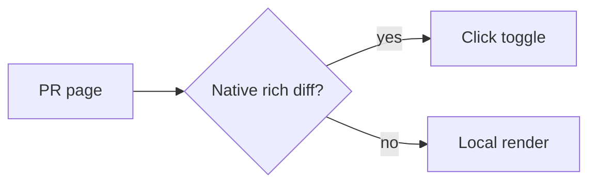
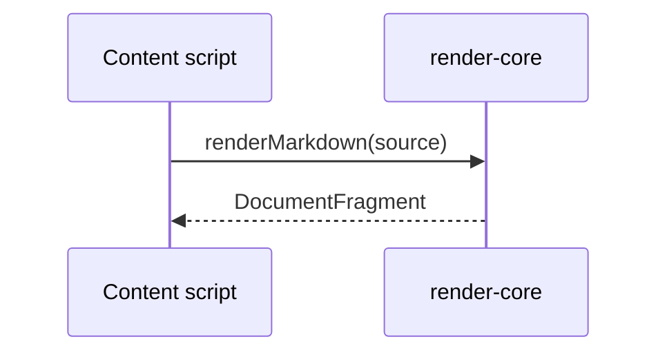

# Diagrams and math

## Flowchart



## Sequence



## Math

Inline math: $E = mc^2$ and $`a^2 + b^2 = c^2`$.

Block math:

$$
\sum_{i=1}^{n} i = \frac{n(n+1)}{2}
$$

```math
\int_0^1 x^2\,dx = \frac{1}{3}
```

A price like $5 and $10 is not math.
